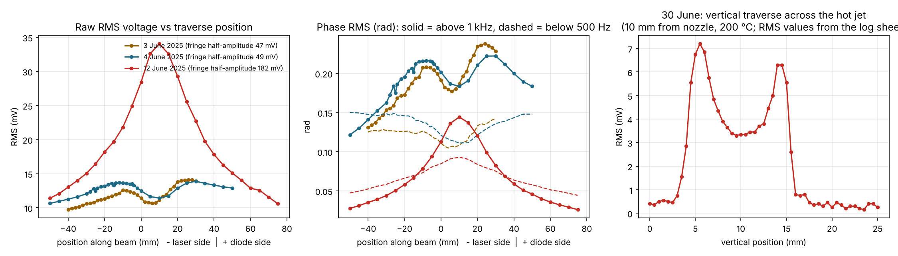

# FLDI-Research
Code and documentation for research on Focused Laser Differential Interferometry (FLDI) for compressible-flow diagnostics.

## Research context

The work is being conducted at the Indian Institute of Science (IISc), within the Turbulent Shear Flow Physics and Engineering Laboratory.

The broader objective is to develop an FLDI diagnostic suitable for future implementation in the Roddam Narasimha Hypersonic Wind Tunnel.

## Contents

| Folder | What it holds |
|---|---|
| `acquisition/` | `DAQ_FLDI_Setup.m`, the MATLAB script used to record the photodiode signal (NI DAQ, 10 kHz, 5 s per run) |
| `analysis/` | `summer2025_profiles.py`, which computes the sensitivity profiles and makes the overview figure |
| `data/summer-2025/logs/` | Experiment log sheets for 3, 4, 12 and 30 June 2025 |
| `data/summer-2025/processed/` | Per-position statistics derived from the raw recordings, and the 30 June traverse values |
| `docs/` | `FLDI_DAQ_script_explained.pdf` (with LaTeX source): a walkthrough of the acquisition script, the run conventions and how to convert the recorded RMS voltage to optical phase |
| `figures/` | `summer2025_overview.png` |

## Summer 2025 bench campaign

The aim was to characterise the spatial sensitivity of the FLDI on an optical rail, using a hot-air gun as a controlled source of density fluctuations.

**Method.** Each day began with gun-off runs (instrument noise) and a Wollaston prism sweep to find the fringe extremes V<sub>min</sub>, V<sub>max</sub> and set the bias at mid-fringe (quadrature). The gun was then traversed along the optical axis (3, 4 and 12 June), with 2–3 repeat runs per position, or vertically across the beam near the focus (30 June). Positions are signed: negative towards the laser, positive towards the photodiode.

**Converting to phase.** Near quadrature, the RMS phase fluctuation is φ<sub>rms</sub> ≈ 2V<sub>rms</sub> / (V<sub>max</sub> − V<sub>min</sub>). This makes days with different fringe contrast comparable.



**Findings.**
- **3 and 4 June:** fringe contrast was low (about 17 %), and the profiles are broad and double-humped with no clear focus. These are best treated as alignment runs.
- **12 June:** after realignment, contrast was 94 % and the profile is a single peak (about 10 mm from the scale zero). The variance FWHM is about 34 mm overall and about 27 mm for content above 1 kHz. Low-frequency content (below 500 Hz) is much less localised, as FLDI theory predicts: small scales are rejected closer to the focus than large ones.
- **30 June** (250 kHz sampling): a vertical traverse 10 mm from the gun nozzle resolves the two shear layers (about 8.75 mm apart) and the quieter core of the hot jet, with edges about 1 mm wide.

**Caveats.** At 10 kHz sampling, content above 5 kHz aliases into the 0–5 kHz band; the 12 June spectra at the focus are still high at 5 kHz, so the RMS there includes some aliased energy. The 12 June log sheet lists V<sub>min</sub> as 0.124 V; the recordings show 0.0124 V, which is used in the analysis.

## Data availability

The raw recordings are not stored in this repository:
- Summer 2025 campaign (3–12 June): about 300 MATLAB files, 145 MB.
- 27 June 2025 sensitivity sweep: about 2 GB.

They are available from the author on request. The processed CSV files in `data/summer-2025/processed/` are enough to reproduce the figure.

## Reproducing the figure

```bash
pip install numpy scipy matplotlib
python analysis/summer2025_profiles.py                          # from the processed CSVs
python analysis/summer2025_profiles.py --raw "/path/to/FLDI Expts"  # recompute from raw data
```

## Notes

Research materials will be shared only where permitted by the laboratory and supervisor.
