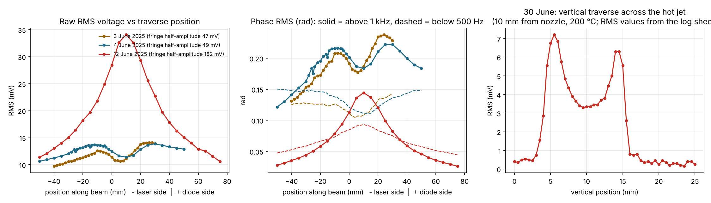
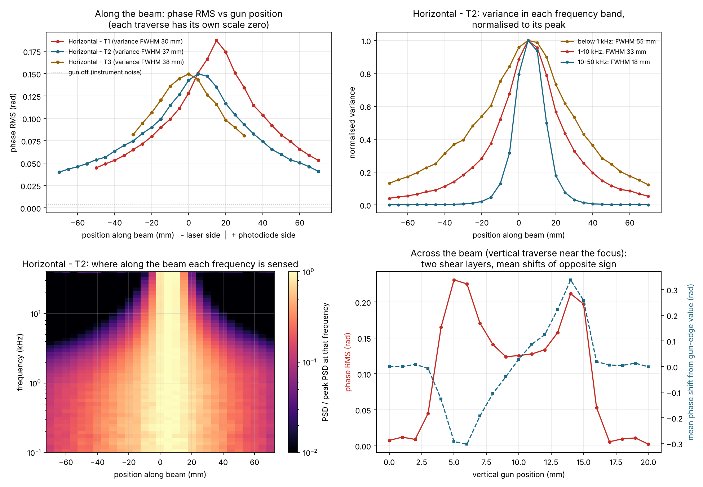

# Summer 2025 bench campaign

Characterising the spatial sensitivity of the FLDI on an optical rail, using a hot-air gun as a controlled source of density fluctuations. June 2025.

## Contents

| Folder | What it holds |
|---|---|
| `acquisition/` | `DAQ_FLDI_Setup.m`, the MATLAB script used to record the photodiode signal (NI DAQ, 5 s per run; 10 kHz on 3–12 June, 250 kHz on 27 and 30 June) |
| `analysis/` | `summer2025_profiles.py` (3–12 and 30 June) and `june27_profiles.py` (27 June), which compute the sensitivity profiles and make the figures |
| `data/logs/` | Experiment log sheets for 3, 4, 12, 27 and 30 June 2025 |
| `data/processed/` | Per-position statistics derived from the raw recordings (including frequency-band breakdowns and a frequency–position map for 27 June), and the 30 June traverse values |
| `docs/` | `FLDI_DAQ_script_explained.pdf` (with LaTeX source): a walkthrough of the acquisition script, the run conventions and how to convert the recorded RMS voltage to optical phase |
| `figures/` | `summer2025_overview.png`, `june27_overview.png` |

## Method

Each day began with gun-off runs (instrument noise) and a Wollaston prism sweep to find the fringe extremes V<sub>min</sub>, V<sub>max</sub> and set the bias at mid-fringe (quadrature). The gun was then traversed along the optical axis (3, 4, 12 and 27 June), with 2–3 repeat runs per position, or vertically across the beam near the focus (27 and 30 June). On 27 June the gun nozzle was 10 mm from the beam at 200 °C. Positions are signed: negative towards the laser, positive towards the photodiode.

Near quadrature, the RMS phase fluctuation is φ<sub>rms</sub> ≈ 2V<sub>rms</sub> / (V<sub>max</sub> − V<sub>min</sub>). This makes days with different fringe contrast comparable.



## Findings

- **3 and 4 June:** fringe contrast was low (about 17 %), and the profiles are broad and double-humped with no clear focus. These are best treated as alignment runs.
- **12 June:** after realignment, contrast was 94 % and the profile is a single peak (about 10 mm from the scale zero). The variance FWHM is about 34 mm overall and about 27 mm for content above 1 kHz. Low-frequency content (below 500 Hz) is much less localised, as FLDI theory predicts: small scales are rejected closer to the focus than large ones.
- **27 June** (250 kHz sampling, the most complete dataset; see below): three traverses along the beam and one across it.
- **30 June** (250 kHz sampling): a vertical traverse 10 mm from the gun nozzle resolves the two shear layers (about 8.75 mm apart) and the quieter core of the hot jet, with edges about 1 mm wide.

## 27 June in detail



- **Along the beam (top left).** Three traverses give variance FWHMs of 30, 37 and 38 mm, consistent with 12 June. The peak phase RMS is 0.15–0.19 rad, against an instrument noise floor of about 0.003 rad, so the signal-to-noise ratio is about 35 dB. Each traverse had its own scale zero, so peak positions differ between traverses.
- **Localisation depends on frequency (top right and bottom left).** The FWHM shrinks from about 55 mm below 1 kHz, to 33 mm at 1–10 kHz, to 18 mm at 10–50 kHz. The frequency–position map shows the same funnel shape: high frequencies are sensed only near the focus, low frequencies over a wide stretch of the beam. This is the scale-dependent rejection expected from FLDI theory, measured directly.
- **Frequency content.** At the focus, 16–26 % of the fluctuation variance is above 5 kHz and under 0.1 % above 40 kHz. Above about 65 kHz the signal is at the noise level. So the 10 kHz sampling used on 3–12 June folded a significant part of the signal into the wrong frequencies, while 250 kHz captures everything.
- **Across the beam (bottom right).** The vertical traverse resolves the two shear layers of the hot jet about 9 mm apart, with a quieter core between them. The mean phase shifts in opposite directions at the two shear layers (about −0.3 and +0.34 rad). FLDI responds to density *gradients*, and the mean gradient has opposite signs on the two edges of a hot jet; this shows the beam separation has a component along the vertical traverse direction.

## Caveats

At 10 kHz sampling, content above 5 kHz aliases into the 0–5 kHz band; the 12 June spectra at the focus are still high at 5 kHz, so the RMS there includes some aliased energy. The 12 June log sheet lists V<sub>min</sub> as 0.124 V; the recordings show 0.0124 V, which is used in the analysis.

On 27 June, the strongest fluctuations swing close to the fringe extremes (V<sub>min</sub>, V<sub>max</sub>), so the response there is slightly compressed and the peak phase RMS is a slight underestimate. In Horizontal T1, the position labels saved inside the files kept saying "laser" after the traverse crossed to the photodiode side; positions are taken from the log sheet instead. Horizontal T2 has no Wollaston sweep files of its own and uses the T1 fringe values.

## Data availability

The raw recordings are not stored in this repository:
- 3–12 June: about 300 MATLAB files, 145 MB.
- 27 June: 204 MATLAB files at 250 kHz, about 2.2 GB.

They are available from the author on request. The processed CSV files in `data/processed/` are enough to reproduce the figure.

## Reproducing the figure

From this folder:

```bash
pip install numpy scipy matplotlib
python analysis/summer2025_profiles.py                          # from the processed CSVs
python analysis/summer2025_profiles.py --raw "/path/to/FLDI Expts"  # recompute from raw data
python analysis/june27_profiles.py                              # 27 June, from the processed CSVs
python analysis/june27_profiles.py --raw "/path/to/27 June 2025"   # 27 June, from raw data
```
